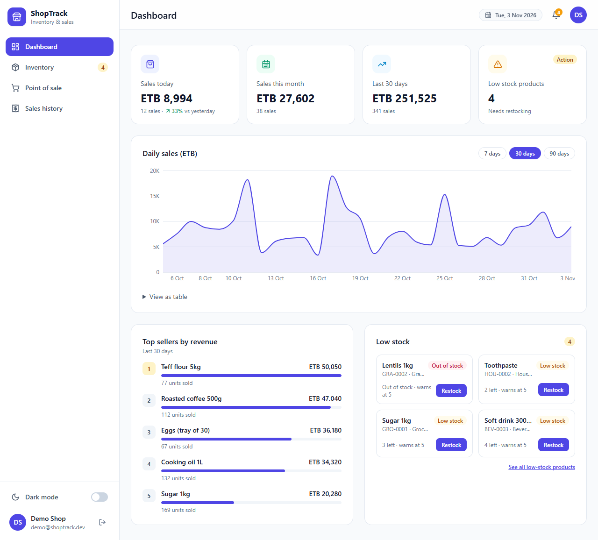
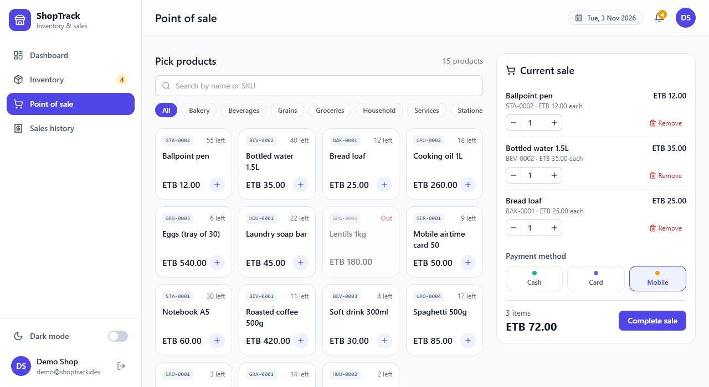
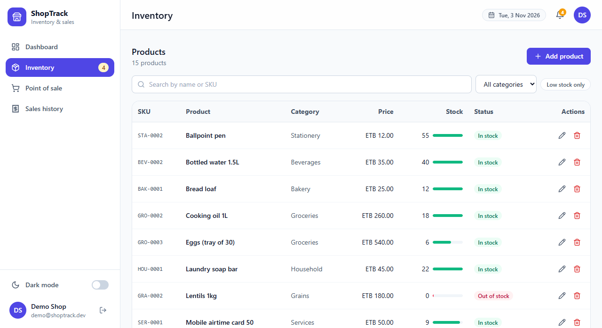
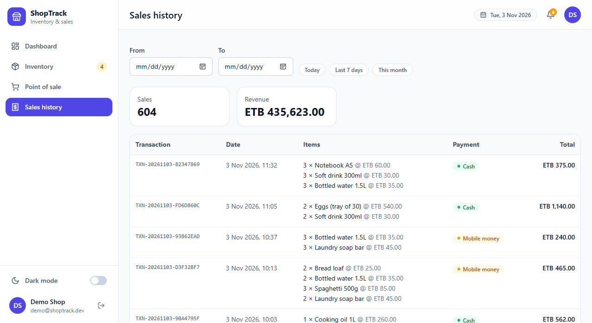
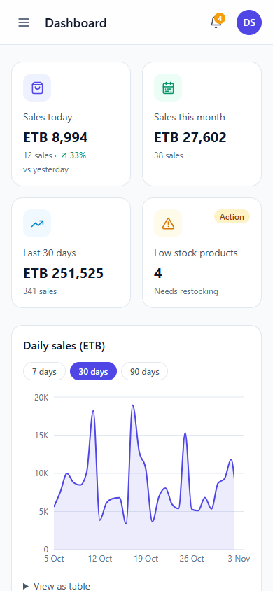
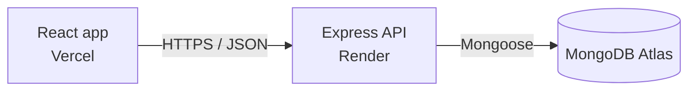

# ShopTrack

Inventory and sales tracker for small shops. A shop owner manages products, records sales (stock drops automatically), and sees daily revenue, top sellers and low-stock warnings on a dashboard.


## Screenshots



| Point of sale | Inventory |
| --- | --- |
|  |  |

| Sales history | Mobile dashboard |
| --- | --- |
|  |  |

Regenerate them with `cd client && npm run screenshots` (uses the installed Edge or Chrome and the demo shop data).

## Features

- Register and log in (JWT authentication, bcrypt password hashing)
- App shell: left sidebar (indigo active state, low-stock badge), page title bar, date chip, low-stock notification bell and initials avatar; slide-in menu on phones
- Dark mode from the sidebar, remembered per browser and applied to every screen including the charts
- Inventory: add, edit, delete, search by name or SKU, category filter, "low stock only" filter, auto-generated unique SKU codes, In stock / Low stock / Out of stock badges
- Point of sale: product card grid with category chips, quantity steppers and a Cash / Card / Mobile money choice; on phones a "View checkout" bar stays at the bottom
- Sales: build a basket, complete the sale, stock is reduced safely, each sale gets a transaction id and a payment pill
- Sales history with transaction ids, payment pills and date filters (Today, Last 7 days, This month, custom range)
- Dashboard: today compared with yesterday, month and period totals, daily sales chart (7, 30 or 90 days), ranked top sellers, low-stock cards with a Restock button, each chart with a table view
- Every shop owner sees only their own data
- Responsive layout, keyboard focus styles, screen-reader labels

## Tech stack

| Part | Technology |
|---|---|
| Front end | React 18, Vite, React Router, Tailwind CSS, Recharts, Lucide icons |
| Back end | Node.js, Express |
| Database | MongoDB Atlas with Mongoose |
| Security | JWT, bcryptjs, helmet, express-rate-limit, CORS allow-list |
| Hosting | Vercel (client), Render (API), Atlas (database) |



## Design decisions worth knowing

**Safe stock reduction.** Selling an item runs one atomic update: "subtract the quantity only if `stock >= quantity`". The check and the subtraction cannot be separated, so two simultaneous sales can never push stock below zero. A multi-item sale runs inside a MongoDB transaction, so if one line fails, the stock taken for the other lines is rolled back.

**Prices come from the server.** The browser sends only product ids and quantities. The server reads names and prices from the database, so a request cannot be edited to sell something for a made-up price.

**Stock codes and transaction ids.** Each product gets a SKU such as `GRO-0001` (auto-generated, editable, unique inside the shop) and each sale gets a reference such as `TXN-20261103-AB12CD`. The unique indexes are partial so a database from before this redesign can be upgraded with `npm run backfill` without failing the index build.

**Payments.** Every sale records `cash`, `card` or `mobile`. The history shows it as a coloured pill, and the payment method is chosen in the checkout panel. The server validates the value; it is never trusted blindly.

**Sales store a snapshot.** Each sale line copies the product name and price at the time of sale. Changing or deleting a product later never rewrites history.

**Ownership on every query.** Every product, sale and report query filters by the logged-in owner. Update and delete match on both id and owner, so guessing another shop's id returns 404. Routes whitelist the fields they accept, which prevents mass assignment.

**Input handling.** Request fields must be strings (stops NoSQL injection such as `{"email": {"$ne": null}}`), body size is capped, passwords are 8 to 72 characters, login and register are rate limited, and search text is regex-escaped.

**Time zones.** The browser sends its time zone, and the server groups sales by day in that zone, so a sale at 1 a.m. in Addis Ababa lands on the right day. Days with no sales are filled with 0 so charts have no gaps.


## Run locally

You need Node.js 18 or newer and a free MongoDB Atlas cluster.

```bash
# 1. API
cd server
npm install
cp .env.example .env      # then fill in MONGODB_URI and JWT_SECRET
npm run backfill          # upgrades an existing database (safe on a fresh one too)
npm run seed              # optional: demo data, login demo@shoptrack.dev / demo1234
npm run dev               # http://localhost:5000

# 2. Client (new terminal)
cd client
npm install
npm run dev               # http://localhost:5173
```

### Environment variables

| Where | Name | Meaning |
|---|---|---|
| server | `MONGODB_URI` | Atlas connection string (include the database name) |
| server | `JWT_SECRET` | Long random text, at least 16 characters |
| server | `CLIENT_URL` | Allowed front-end address(es), comma separated, no trailing slash |
| server | `PORT` | Set automatically by most hosts |
| client | `VITE_API_URL` | Deployed API address ending in `/api` (not needed locally) |
| client | `VITE_DEMO` | `true` shows the "Try the demo shop" button |


## Possible improvements

- Void or refund a sale and restore its stock
- Automated tests for the sales and reports routes
- Multiple staff accounts with roles
- Payment-method breakdown on the dashboard
- Printable receipts and CSV export
- Store the login token in an httpOnly cookie instead of localStorage
